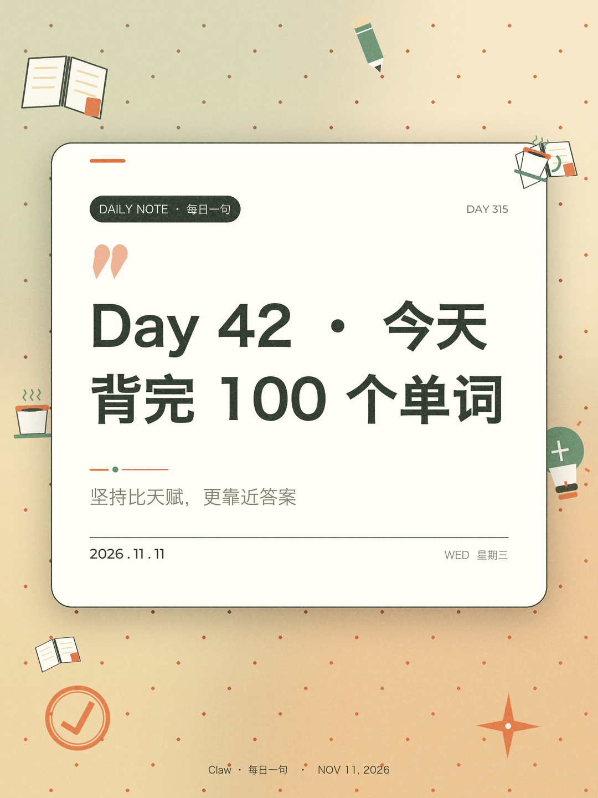

# daily-card

输入 **标题 + 副标题**，生成一张可发朋友圈 / 公众号 / 小红书的卡片图：自动带当天日期、按文案主题匹配的矢量贴纸、成套统一的配色。纯本地渲染，中文文字 100% 可控，同参数结果可复现。

| 学习打卡 | 早安方图 | 自定义背景取色 |
| --- | --- | --- |
|  |  |  |

## 为什么是本地脚本

AI 整图生成容易把中文标题糊掉，而且脚本没法独立运行。这里用「程序化排版 + 矢量插画贴纸」：文字清晰、可复现、不联网、不需要 API Key。想要照片感背景，用 `--bg-image` 塞一张图进来，脚本负责排字并从图里取色统一整套配色。

## 快速开始

```bash
git clone <仓库地址> daily-card
cd daily-card
./install.sh                       # 装依赖、初始化私有配置、跑自检
python3 cardgen.py "今天也要好好生活" "把普通的日子，过得响亮一点"
```

`./install.sh` 幂等，可重复执行，不会覆盖已有主题配置。也可以手动：

```bash
python3 -m pip install -r requirements.txt
python3 cardgen.py --list-themes
```

**前置条件**：Python 3.9+、Pillow、系统里有一个中文字体（macOS 自带；Linux 装 `fonts-noto-cjk`；Windows 自带微软雅黑）。找不到字体时会明确报错并提示用 `--font` 指定。

## 生成卡片

```bash
python3 cardgen.py "标题" "副标题"                       # 默认小红书 1080×1440
python3 cardgen.py -t "Day 42 · 背完 100 个单词" -s "坚持比天赋更靠近答案" --platform xhs
python3 cardgen.py "山不见我，我自去见山" "周末出走计划" --platform wechat
python3 cardgen.py "黄昏是白天给夜晚的回信" "今天也辛苦了" --bg-image ./bg.jpg --bg-scheme 2
python3 cardgen.py                                      # 交互式问答
```

| 平台 | 尺寸 | 用途 |
| --- | --- | --- |
| `xhs` | 1080×1440 | 小红书 3:4 |
| `moments` | 1080×1080 | 朋友圈方图 |
| `wechat` | 900×500 | 公众号横图 |
| `wechat2` | 1080×460 | 公众号 2.35:1 首图 |
| `story` | 1080×1920 | 竖屏 9:16 |

完整参数见 [SKILL.md](SKILL.md)。macOS 可双击 `run.command` 走问答式生成。

## 两种可选后端

| 后端 | 何时需要 | 启用方式 |
| --- | --- | --- |
| 无（默认） | 只用 CLI 出图 | 什么都不做 |
| 本地网页后台 | 要 GUI、实时预览、可视化改主题 | `python3 server.py` → `http://127.0.0.1:8777` |
| 远程服务器 | 团队共享、给 agent 稳定端点 | nginx 子路径反代 + `server.py --api-only`，设 `DAILY_CARD_URL` |

后台是 Python 标准库 `ThreadingHTTPServer` + 单页前端，零新增依赖。三个面板：卡片设计（实时预览 / 下载 / 保存）、主题配置（三栏，含**未保存草案的实时效果预览**、配色语义图、WCAG 可读性诊断）、全局设置。macOS 可双击 `start-server.command`。

> `server.py` **零鉴权**且默认只监听 `127.0.0.1`。公开部署前请看 [部署文档](docs/DEPLOY.md)，由反向代理承担鉴权，不要直接 `--host 0.0.0.0` 暴露。

### 同域名子路径部署

云服务器常见形态是「一个域名挂多个服务，用 `location /daily-card/` 区分」。本项目按此设计：nginx `alias` 直出前端静态资源，`/daily-card/api/` 剥前缀转发给 `--api-only` 的 Python 服务；前端 URL 全部由运行时 `BASE` 派生，同一份文件在 `/` 和任意子路径都能跑。

```bash
./scripts/publish-web.sh                 # 发布 web/ 到版本目录并切换 current 软链
./scripts/publish-web.sh --rollback      # 秒回滚，不需要重启 Python
```

前端静态版本因此可独立于后端发版。完整 nginx 配置、systemd、缓存与鉴权说明见 [docs/DEPLOY.md](docs/DEPLOY.md)。

## 目录结构

```
SKILL.md                 agent 说明书（本仓库根目录即 skill 目录）
cardgen.py               渲染器 + CLI
cardconfig.py            配置加载 / 保存 / 背景图取色
cardpreview.py           主题草案预览与配色诊断
server.py                可选网页后台
config/
  themes.default.json    11 套出厂主题（进仓库）
  stickers.json          28 贴纸 + 6 纹样注册表（进仓库）
  themes.json            实际生效的主题（私有，不进仓库）
  settings.json          全局设置（私有，不进仓库）
web/                     后台前端
scripts/selfcheck.sh     健康自检，CI 入口（含子路径链路回归）
scripts/publish-web.sh   前端静态版本发布 / 回滚
scripts/test_subpath.py  模拟 nginx 子路径部署的回归测试
docs/DEPLOY.md           服务器部署与 CI/CD 说明
examples/                6 张 demo 成品图（约 6.7 MB，可删）
install.sh               幂等安装 / 更新
```

## 配置是私有数据

`themes.json` 和 `settings.json` 属于使用者自己的数据，**不进版本管理、不随公开仓库发布**。首次运行时 `cardconfig.ensure_config()` 会自动从 `themes.default.json` 生成一份，clone 后无需手动创建。

升级时 `git pull` 只更新出厂模板，不会覆盖你改过的主题。想把新出厂主题合进来，手动从 `themes.default.json` 拷贝条目；**不要**用 `--init-config` 或后台「恢复出厂主题」。详见 [config/README.md](config/README.md)。

## 更新与多端同步

唯一版本真相源是这个 git 仓库，其余各端都是派生：

| 端 | 更新方式 |
| --- | --- |
| 本机 / 云服务器 | `git pull && ./install.sh`（私有配置不受影响） |
| 本机 skill 注册 | `./install.sh --link-skill` 建符号链接，避免文件副本漂移 |
| 云服务器前端静态版本 | `./scripts/publish-web.sh`，可独立于后端发版与回滚 |
| skillhub 等平台 | 打 tag 后重新导入，平台存的是快照，天然有版本滞后 |

服务器部署、反代鉴权、systemd、CI/CD 接入见 [docs/DEPLOY.md](docs/DEPLOY.md)。`scripts/selfcheck.sh` 是统一的 CI 入口（语法、配置、冒烟渲染、私有数据、前端路径可移植性、子路径部署模拟，共 8 步）。

## 作为 Skill 使用

本仓库根目录就是一个符合 Agent Skills 规范的 skill 目录（`SKILL.md` + 同级代码与资源）。把它放进 `~/.workbuddy/skills/`、`~/.claude/skills/`、`~/.agents/skills/` 等路径即可被 agent 发现；GitHub 导入型平台（如 agentskillhub）也可直接识别根目录的 `SKILL.md`。`./install.sh --link-skill` 会自动探测常见路径并建软链。

## 已知限制

- 贴纸只能从 28 个内置矢量贴纸中选择，暂不支持上传自定义 PNG/SVG，也没有独立贴纸库管理面板。**下一版本计划实现**。
- 主题草案预览用 1x 超采样以加快响应，与最终 2x 输出在极细颗粒上略有差异，版式与配色一致。

## 版本与许可

当前版本 `0.5.1`，版本记录见 [CHANGELOG.md](CHANGELOG.md)。采用 [MIT](LICENSE) 许可。
